# Fine-tuning DETR-family Models for Object Detection
Fine-tuning **DETR** and **Conditional DETR** using 🤗 **Hugging Face Transformers** and PyTorch on the [CPPE-5](https://arxiv.org/abs/2112.09569) dataset to detect medical personal protective equipment: **coveralls, face shields, gloves, goggles and masks**. The project
covers the full pipeline: data analysis and a stratified split, training with best-checkpoint selection on
validation mAP, test evaluation, inference on new images, and ONNX export verified against PyTorch.

| Model | Best val mAP | Test mAP | Test mAP@50 | Test mAP@75 | Test mAR@100 |
|---|---:|---:|---:|---:|---:|
| Conditional DETR (`microsoft/conditional-detr-resnet-50`) | **0.286** | **0.304** | **0.585** | **0.260** | 0.509 |
| DETR (`facebook/detr-resnet-50`) | 0.241 | 0.292 | 0.566 | 0.241 | **0.529** |

Conditional DETR achieved a test mAP of 0.304 versus 0.292 for DETR. Both models were fine-tuned on the same CPPE-5 split and evaluated using COCO detection metrics.

## Usage

```bash
cd detr-cppe5
pip install -r requirements.txt
```

All settings live in `config.yaml`. Select the model with `model_choice: detr` or
`model_choice: conditional_detr`, then run:

```bash
python main.py train                  # split the data, train, keep the best checkpoint, evaluate it on test
python main.py predict                # predict on the image set in inference.image (path or URL)
python main.py predict --split test   # ground truth vs. prediction on the test images in inference.test_indices
python main.py export                 # export to ONNX and compare ONNX Runtime with PyTorch
```

Evaluation is part of `train`: the model is evaluated on the validation set after every epoch, only the best
checkpoint is kept, and that checkpoint is evaluated on the test set at the end.

On **Google Colab**, with the project folder in Google Drive:

```python
from google.colab import drive
drive.mount("/content/drive")
%cd /content/drive/MyDrive/detr-cppe5
!pip install -q -r requirements.txt
!python main.py train
```

## Project structure

```
detr-cppe5/
├── main.py              
├── config.yaml          # model choice and all hyperparameters
├── outputs/             # auto-created; holds saved results
├── src/
│   ├── config.py        # loads config.yaml
│   ├── dataset.py       # loading, stratified split, label maps, analysis
│   ├── model.py         # model and image processor
│   ├── train.py         # training loop with per-epoch validation and best-checkpoint saving
│   ├── evaluate.py      # loss and COCO mAP/mAR
│   ├── inference.py     # predictions on test samples
│   ├── export_onnx.py   # ONNX export and ONNX Runtime vs. PyTorch comparison
│   └── utils.py         # augmentation, collate function, box utilities, NMS, plotting
├── README.md            
└── requirements.txt
```

## Models

**DETR** ([Carion et al., 2020](https://arxiv.org/abs/2005.12872)) frames detection as set prediction: a
ResNet-50 backbone and a transformer encoder-decoder turn a fixed set of learned object queries into boxes,
and Hungarian matching assigns each prediction to at most one ground-truth object. It needs no anchors, but
it is known to converge slowly.

**Conditional DETR** ([Meng et al., 2021](https://arxiv.org/abs/2108.06152)) adds a conditional spatial query
to each decoder query so that cross-attention focuses on object extremities earlier. The authors report
6.7×–10× faster convergence than DETR, which matters for a short fine-tuning schedule on a small dataset.

Both models start from COCO-pretrained checkpoints; their classification heads are replaced with new heads
for the 5 CPPE-5 classes.

## Dataset and split

[CPPE-5](https://huggingface.co/datasets/danelcsb/cppe-5-v2) contains real-world images of medical PPE with
COCO-format box annotations. The Hugging Face version used here has 952 training and 29 test images and no
validation split. The training set has a clear class imbalance: goggles and face
shields are about three times rarer than gloves, masks and coveralls.

<p align="center">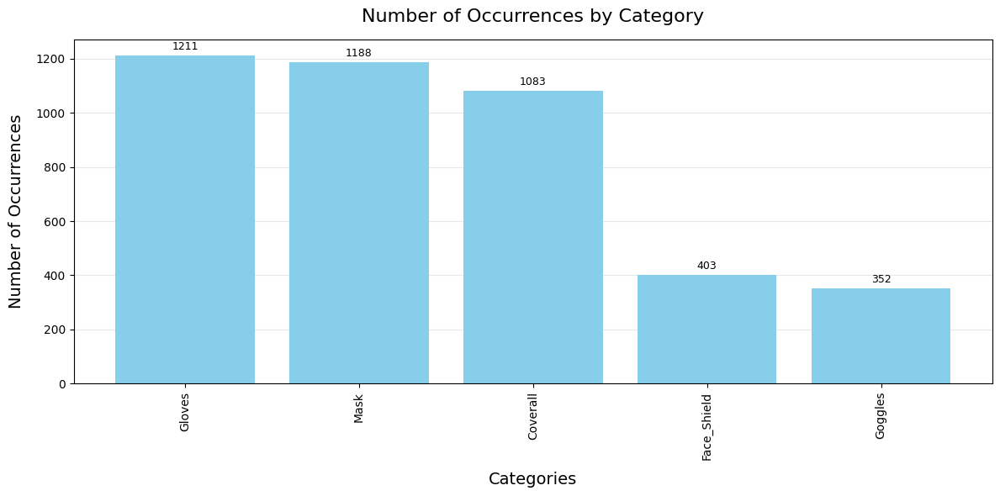</p>

**Validation split.** 15 % of the training images are held out for validation, which gives **809 train,
143 validation and 29 test images**. The validation set is used to select the best checkpoint, so the test set
is only used once, for the final evaluation.

**Why stratify.** With so few goggles and face shields, a random split can leave the validation set with
almost none of them, which makes validation mAP, and therefore checkpoint selection, unreliable for those
classes. Each image is labelled with the rarest class it contains (priority Goggles → Face_Shield → Coverall →
Mask → Gloves) and the split is stratified on that label with
`train_test_split(stratify_by_column=..., seed=1337)`. Rare-class images are then spread proportionally
between train and validation.

## Preprocessing and augmentation

**Augmentation** (training only, [Albumentations](https://albumentations.ai/), boxes transformed with the
image):

| Transform | p | Purpose |
|---|---:|---|
| `Perspective` | 0.1 | viewpoint changes; kept rare so small objects are not distorted |
| `HorizontalFlip` | 0.5 | PPE is left/right symmetric |
| `RandomBrightnessContrast` | 0.5 | lighting varies widely between scenes |
| `HueSaturationValue` | 0.1 | colour variation of gowns and gloves, kept rare since colour is also a useful cue |

Boxes are
clipped to the image (`clip=True`) and boxes smaller than 25 px² after augmentation are dropped
(`min_area=25`). Validation and test images are not augmented.

**Image processor** (all images): the Hugging Face processor of each checkpoint rescales and normalises the
image (ImageNet mean/std), resizes it, pads it, and converts boxes to normalised `(cx, cy, w, h)`. Images are
resized to a maximum side of 480 px to keep training fast on a single
GPU:

- **DETR:** fit inside 480×480 and pad to a fixed 480×480 canvas.
- **Conditional DETR:** longest side 480, padded to the largest image in the batch.

## Training setup

Shared settings (`config.yaml`):

| Setting | Value |
|---|---|
| Epochs / batch size | 30 / 8 |
| Optimizer | AdamW, lr 5e-5, weight decay 1e-4 (no decay on biases and norm layers) |
| LR schedule | cosine, no warmup |
| Gradient clipping | max norm 0.01 |
| Checkpoint selection | best validation mAP, evaluated after every epoch |
| Seeds | 1337 (data split), 42 (training) |

Model-specific settings:

| Setting | DETR                                                     | Conditional DETR |
|---|----------------------------------------------------------|---|
| Mixed precision (fp16) | off (Hungarian matching / GIoU loss is unstable in fp16) | on |
| Inference score threshold | 0.45                                                     | 0.3 |
| Class-wise NMS at inference (IoU 0.5) | on                                                       | off |

Both models were trained on Google Colab with a single GPU, about 32 minutes for conditional-detr and 34 minutes for detr.

## Evaluation metrics

Metrics are the standard COCO detection metrics computed with `torchmetrics.MeanAveragePrecision`:

- **mAP@[.50:.95]**: the primary metric, used for checkpoint selection; averages precision over IoU thresholds
  0.50–0.95, so it rewards both detection and localisation quality.
- **mAP@50 / mAP@75**: precision at a loose and a strict IoU threshold.
- **mAP small / medium / large**: by object area (< 32², 32²–96², > 96² pixels).
- **mAR@1 / @10 / @100**: recall with at most 1, 10 or 100 detections per image.
- **Per-class mAP and mAR@100**.

All predictions are kept during evaluation (score threshold 0), as mAP integrates over the full
precision-recall curve. The inference thresholds above only affect visualisations.

## Results

### Training

DETR improves faster during the first epochs, but Conditional DETR overtakes it around epoch 13 and finishes
clearly ahead on validation (0.286 vs. 0.241). Both curves flatten over the last epochs as the cosine schedule
decays the learning rate, and the best checkpoints come from epochs 28 and 29. Training and validation losses
stay close for both models, with no sign of overfitting.

<table>
  <tr>
    <th>Conditional DETR</th>
    <th>DETR</th>
  </tr>
  <tr>
    <td>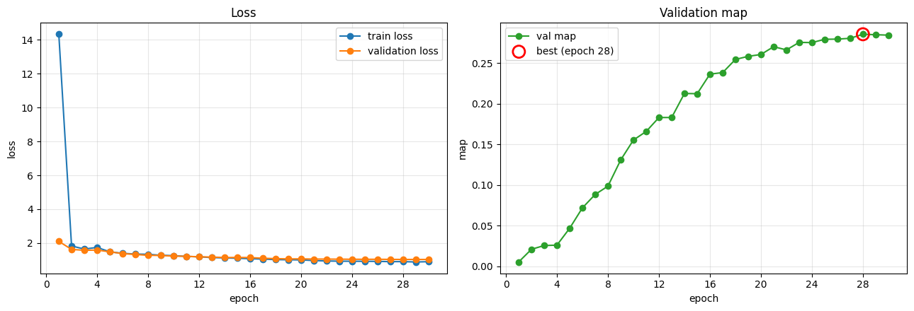</td>
    <td>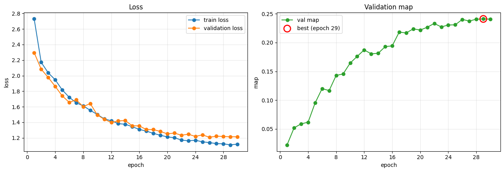</td>
  </tr>
</table>

### Test set

| Metric | Conditional DETR | DETR |
|---|---:|---:|
| mAP@[.50:.95] | **0.304** | 0.292 |
| mAP@50 | **0.585** | 0.566 |
| mAP@75 | **0.260** | 0.241 |
| mAP small | **0.165** | 0.120 |
| mAP medium | 0.179 | **0.214** |
| mAP large | **0.455** | 0.397 |
| mAR@100 | 0.509 | **0.529** |

| Class (mAP) | Conditional DETR | DETR |
|---|---:|---:|
| Coverall | **0.593** | 0.585 |
| Mask | **0.342** | 0.325 |
| Gloves | **0.273** | 0.258 |
| Face_Shield | 0.175 | **0.224** |
| Goggles | **0.138** | 0.070 |

Conditional DETR is slightly better overall and on most classes; DETR does better on face shields and has
slightly higher recall. With only 29 test images, a difference of about one mAP point is within run-to-run
noise, while the validation gap (4.5 points on 143 images) is the more reliable comparison. For both models,
coveralls are detected best and goggles worst.

<details>
<summary>DETR on test images (ground truth in green, predictions in red)</summary>

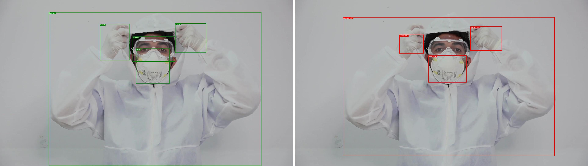
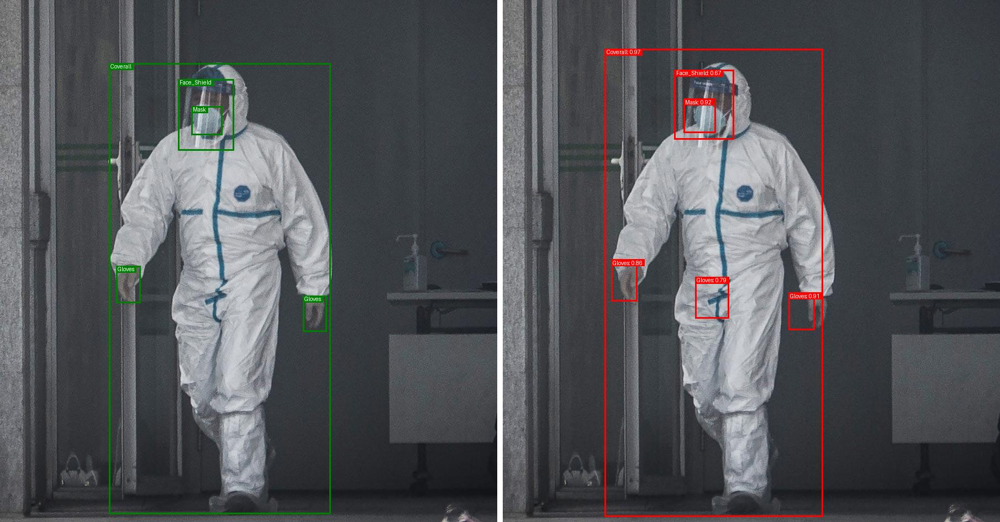
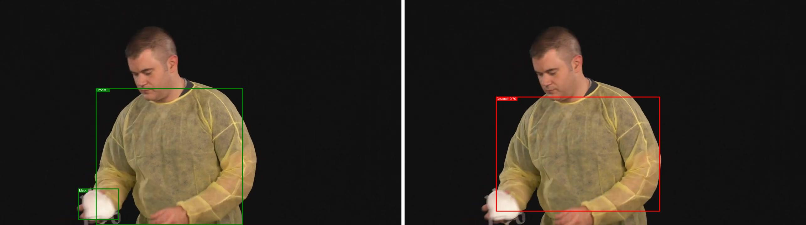

</details>

<details>
<summary>Conditional DETR on test images</summary>

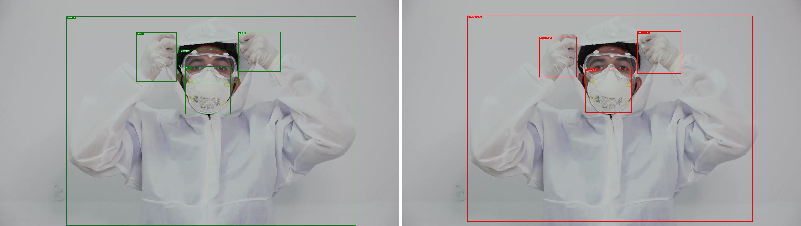
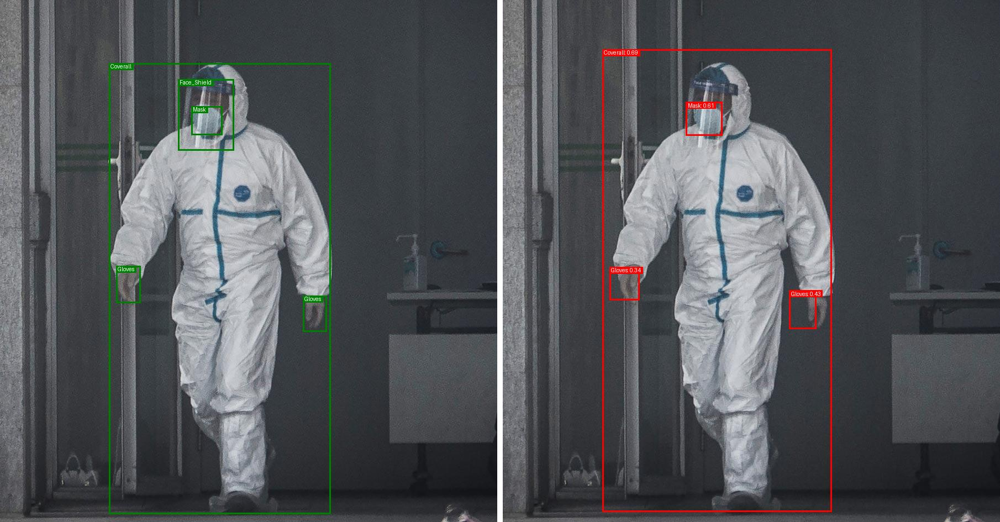
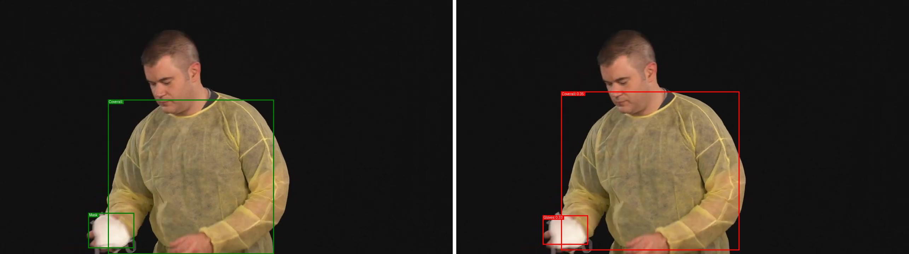

</details>

### Image from the internet

Both models were run on a [Pexels photo](https://images.pexels.com/photos/8413299/pexels-photo-8413299.jpeg?auto=compress&cs=tinysrgb&w=630&h=375&dpr=2)
that is not part of CPPE-5.

<table>
  <tr>
    <th>Conditional DETR</th>
    <th>DETR</th>
  </tr>
  <tr>
    <td></td>
    <td></td>
  </tr>
</table>

## ONNX export

`python main.py export` exports the best checkpoint to ONNX so the model can be served with
[ONNX Runtime](https://onnxruntime.ai/) (CPU or GPU, from Python, C++, C#, Java or JavaScript) without
PyTorch or `transformers`.

- Exported with `torch.onnx.export`, opset 17, validated with `onnx.checker`.
- Inputs: `pixel_values` (batch, 3, H, W) and `pixel_mask` (batch, H, W). Outputs: `logits` and `pred_boxes`.
- Batch size, height and width are dynamic.
- The image processor configuration is saved next to `model.onnx`, so pre- and post-processing match PyTorch.

After exporting, the same images are run through PyTorch and ONNX Runtime and both the raw outputs and the
final detections are compared.

<details>
<summary>Conditional DETR: ONNX vs. PyTorch</summary>

| Image | Input | Max abs. diff. (logits / boxes) | Detections (PyTorch / ONNX) | Max box diff. |
|---|---|---|---|---:|
| Internet image | 320×480 | 8.5e-5 / 1.3e-5 | 5 / 5 | 0.00 px |
| Test 0 | 272×480 | 4.9e-5 / 5.6e-5 | 6 / 6 | 0.01 px |
| Test 1 | 240×480 | 5.2e-5 / 3.8e-5 | 3 / 3 | 0.00 px |
| Test 2 | 480×457 | 3.8e-5 / 2.9e-5 | 4 / 4 | 0.00 px |
| Test 3 | 270×480 | 1.3e-5 / 2.4e-5 | 2 / 2 | 0.00 px |

All differences are far below the 1e-3 tolerance, and the post-processed detections are identical (same
boxes, labels and scores).

<table>
  <tr>
    <th>ONNX</th>
    <th>PyTorch</th>
  </tr>
  <tr>
    <td></td>
    <td>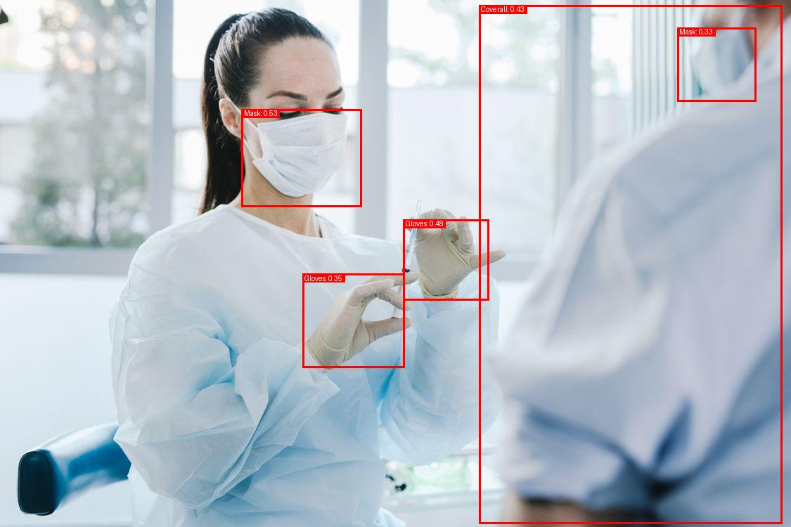</td>
  </tr>
</table>
</details>

<details>
<summary>DETR: ONNX vs. PyTorch</summary>

| Image | Input   | Max abs. diff. (logits / boxes) | Detections (PyTorch / ONNX) | Max box diff. |
|---|---------|---------------------------------|-----------------------------|--------------:|
| Internet image | 480×480 | 5.5e-5 / 1.3e-5                 | 5 / 5                       |       0.00 px |
| Test 0 | 480×480 | 3.3e-5 / 5.6e-6                 | 4 / 4                       |       0.00 px |
| Test 1 | 480×480 | 6.2e-5 / 2.2e-5                 | 3 / 3                       |       0.00 px |
| Test 2 | 480×480 | 2.1e-3 / 2.8e-5                 | 6 / 6                       |       0.01 px |
| Test 3 | 480×480 | 1.8e-5 / 7.9e-6                 | 1 / 1                       |       0.00 px |

<table>
  <tr>
    <th>ONNX</th>
    <th>PyTorch</th>
  </tr>
  <tr>
    <td></td>
    <td>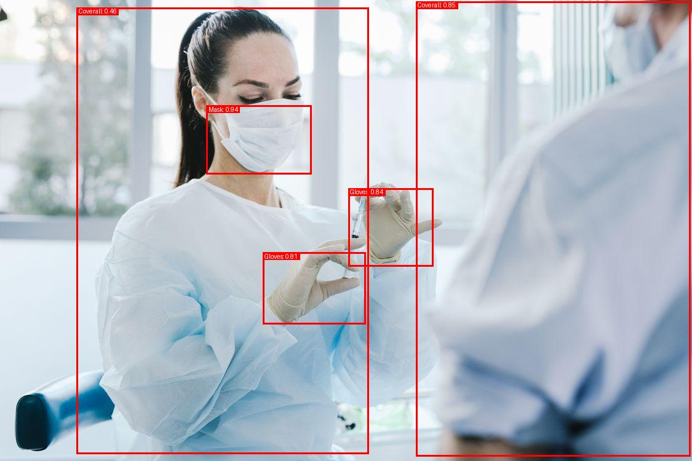</td>
  </tr>
</table>
</details>


## Limitations

- **Small evaluation sets.** 143 validation and 29 test images make the metrics noisy.
- **Rare and small classes.** Goggles and face shields remain the weakest classes; more data, class-balanced
  sampling or a higher input resolution would likely help.
- **Short schedule and low resolution.** 30 epochs at 480 px is short for DETR-style models; longer schedules
  and larger inputs are the usual way to improve them, especially for small objects.

## References

- N. Carion et al., *End-to-End Object Detection with Transformers*, ECCV 2020. [arXiv:2005.12872](https://arxiv.org/abs/2005.12872)
- D. Meng et al., *Conditional DETR for Fast Training Convergence*, ICCV 2021. [arXiv:2108.06152](https://arxiv.org/abs/2108.06152)
- R. Dagli and A. M. Shaikh, *CPPE-5: Medical Personal Protective Equipment Dataset*, 2021. [arXiv:2112.09569](https://arxiv.org/abs/2112.09569)
- Hugging Face, [Object detection guide](https://huggingface.co/docs/transformers/tasks/object_detection)
